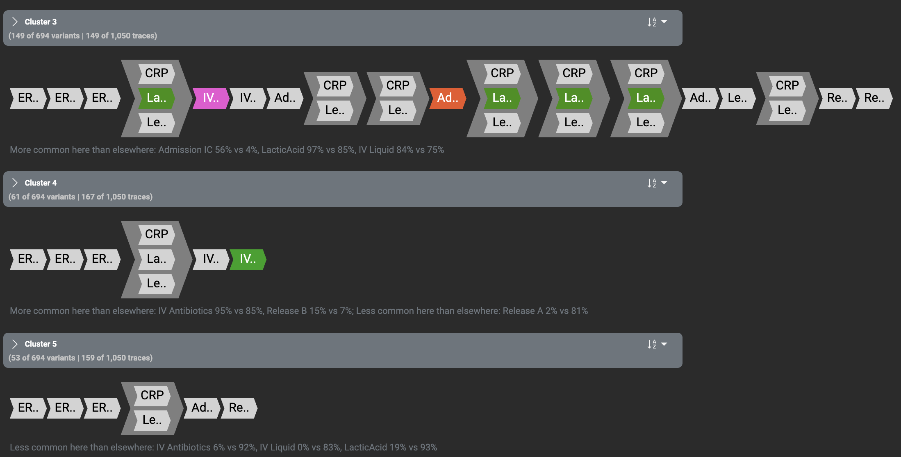
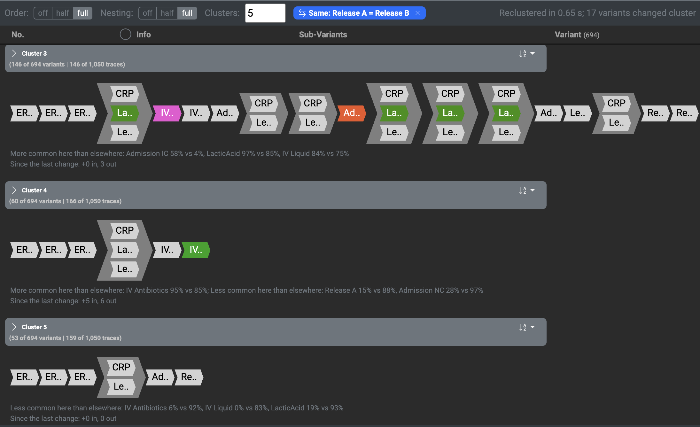
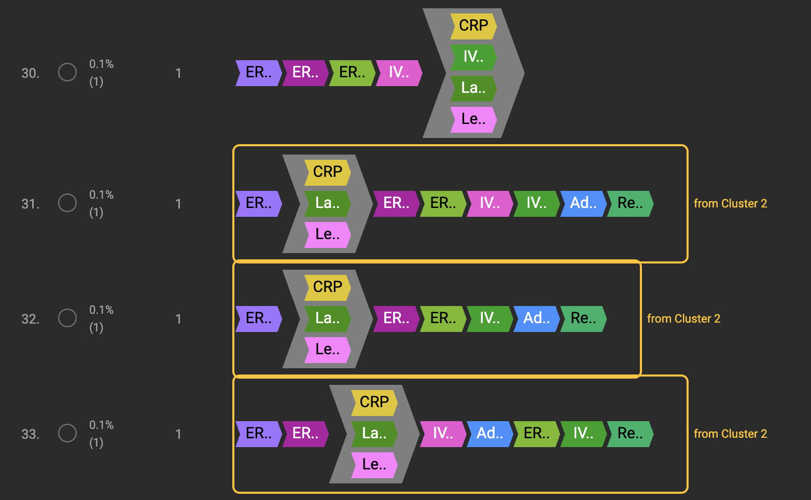

# Interactive Variant Clustering with Rotation-HRR

## Overview

This extension adds a variant clustering to Cortado that the analyst can steer while looking at the clusters. Every variant tree is encoded as one vector with **Rotation-HRR**, and the vectors are clustered with **COP-KMeans**, which keeps must-link and cannot-link constraints during the clustering instead of repairing the clusters afterwards.

The analyst can change the clustering in five ways:

- **Order** and **Nesting** set how much the order of the activities and their depth inside parallel blocks count (off, half or full).
- **Same** declares two or more activities the same activity, for example two release activities that differ only in their name.
- **Ignore** leaves an activity out of the clustering.
- **Must-link** and **cannot-link** state that two variants belong to the same cluster or to different clusters.

Every input reclusters at once, starting from the clusters on the screen, so that a variant changes cluster only because of the input. The variants that changed cluster are marked, and every earlier state can be brought back.

<!-- Demo video: drag the .mp4 file into the GitHub editor here; GitHub turns it into a player. -->


# Installation

Follow [Download and Run](README.md#download-and-run) in the README.


# Using the Extension

## Step 1: Import an Event Log

Import an event log as in Cortado. The variants appear in the Variant Explorer.

## Step 2: Create the Clustering

Open

```
Functions
→ Variant Clustering
```

and select **HRR clustering (COP-KMeans)**. Choose Order, Nesting and the number of clusters and click **Apply**.

<!-- Screenshot: the clustering dialog with HRR clustering (COP-KMeans) selected -->

The clusters appear in the Variant Explorer, together with a strip of controls above them.

## Step 3: Read the Clusters

The header of each cluster shows its number of variants and traces, its **representative** and a line with the **activities that set the cluster apart**:

- The representative is the variant of the cluster whose vector lies closest to the centre of the cluster. In the representative, the activities that the line names as more common in the cluster keep their colours; all other activities are grey.
- The line names up to three activities whose share in the cluster differs most from their share in the other clusters, for example *Admission IC 56% vs 4%*: 56% of the cluster's variants contain Admission IC, against 4% of the other variants. An activity is only named when Fisher's exact test finds the difference (p < 0.05).



*Figure 1. Three clusters of the Sepsis Cases log. Cluster 5 is set apart by activities that its variants rarely contain, so its representative is grey throughout.*

## Step 4: Change How Much Order and Nesting Count

Use the **Order** and **Nesting** buttons in the strip. **Off** removes the order (or the depth) from the comparison, **half** lets it count half, and **full** lets it count fully. The clustering is recomputed at once, and the strip reports how long it took and how many variants changed cluster.

## Step 5: Declare Activities the Same

In the **Activity Overview**, tick two or more activities and click **Same**. They are compared as one activity from then on, while their positions in the variants stay as they are. A badge such as **Same: Release A = Release B** appears in the strip; its **×** removes the declaration again.



*Figure 2. The clustering of Figure 1 after Release A and Release B are declared the same: 17 of the 694 variants changed cluster.*

## Step 6: Ignore an Activity

Click the eye next to an activity in the Activity Overview. The activity is left out of every variant, and the activities after it move up by one place. A badge **Ignored: …** appears in the strip.

<!-- Screenshot: the Activity Overview with the Same column and an ignored activity -->

## Step 7: Add Must-Link and Cannot-Link Constraints

Select exactly two variants in the Variant Explorer and click the green (must-link) or red (cannot-link) button, as in the [constrained clustering](INTERACTIVE_CONSTRAINED_CLUSTERING.md) of the original project. With HRR clustering, the constraint is applied at once: COP-KMeans assigns no variant to a cluster that would break a constraint. A constraint that contradicts the others is refused, and if the constraints cannot all be met with the chosen number of clusters, a message names the variant that cannot be placed.

## Step 8: See What Changed

After every input:

- the strip reports how many variants changed cluster;
- the header of each cluster shows under **Since the last change** how many variants joined and left it;
- every variant that joined a cluster is framed and tagged with the cluster it came from.



*Figure 3. Part of cluster 4 after the declaration of Figure 2: three of the five variants that joined it, each tagged with the cluster it came from.*

## Step 9: Go Back or Start Over

Removing the last input, with the **×** of its badge, brings back the clustering that was shown before it; every combination of inputs that was already visited is restored at once. **Recluster from scratch** clusters the variants anew from ten starts and keeps the best clustering, so that the result no longer depends on the order in which the inputs were made. Changing the number of clusters also clusters from scratch.


# How It Works

```text
Event log
    │
    ▼
Variant trees (Cortado)
    │
    ▼
Adjusted trees ◄── Same, Ignore
    │
    ▼
Rotation-HRR vectors ◄── Order, Nesting
    │
    ▼
COP-KMeans ◄── Must-link, Cannot-link, number of clusters
    │
    ▼
Clusters, representatives, activities that set each cluster apart
```

**Rotation-HRR.** Every activity is assigned a random vector of 8192 numbers. In a variant, each activity's vector is turned, in pairs of numbers, by angles that grow with the activity's position and with its depth, and the variant's vector is the sum of the turned vectors. The position of an activity inside a parallel block is its average position over all orders that the block allows, so every order of a parallel block counts alike. The distance of two variants is the angle between their vectors divided by π, between 0 and 1. Order and Nesting multiply the angles by 0, 0.5 or 1.

**Clustering.** COP-KMeans clusters the vectors, scaled to length 1. After an input, it starts from the clusters on the screen: each cluster's centre is placed at the mean of the new vectors of its variants, and the new clusters are numbered so that as many variants as possible keep their cluster number. Every clustering is kept, so that a state that was visited before is restored without clustering again.

**Code.** The encoding is in [rotation_hrr/](rotation_hrr/), the clustering endpoint in [hrr_clustering.py](src/backend/api/routes/variants/hrr_clustering.py), COP-KMeans in [cop_kmeans.py](src/backend/api/routes/variants/cop_kmeans.py) (adapted from Behrouz Babaki's [COP-Kmeans](https://github.com/Behrouz-Babaki/COP-Kmeans)), and the controls in [hrr-clustering-bar](src/frontend/src/app/components/variant-explorer/hrr-clustering-bar/) and [hrrClusteringService](src/frontend/src/app/services/hrrClusteringService/).


# Notes

- Every input except a new number of clusters is answered within a few seconds on the six evaluated logs. The first clustering, a new number of clusters and Recluster from scratch run COP-KMeans ten times and take up to about 100 seconds on the BPI Challenge 2017 log.
- The tool uses one seed for its random vectors. A variant that lies almost equally close to two centres can therefore end up in either cluster.
- Variants that Cortado represents with a fallthrough node are encoded as if the node were a parallel block.
- The constraints apply to the currently loaded event log; loading a new log clears them.
