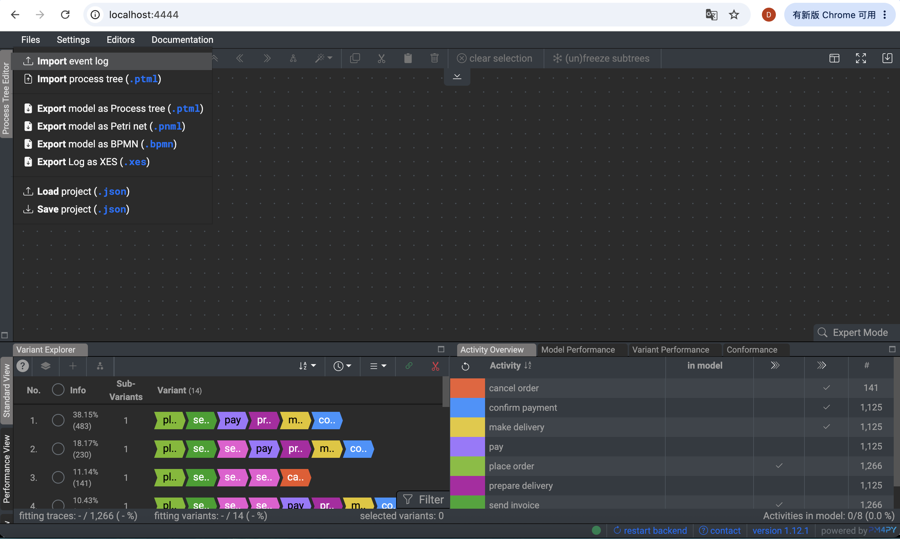
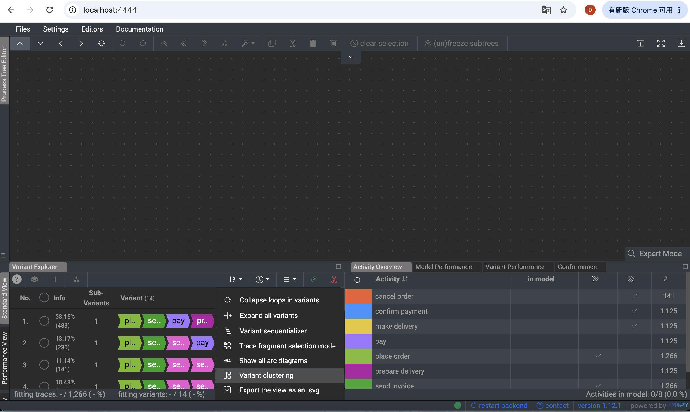
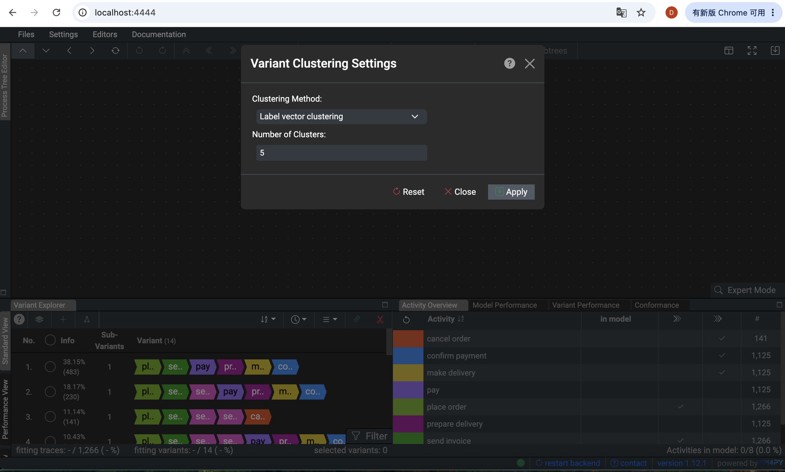
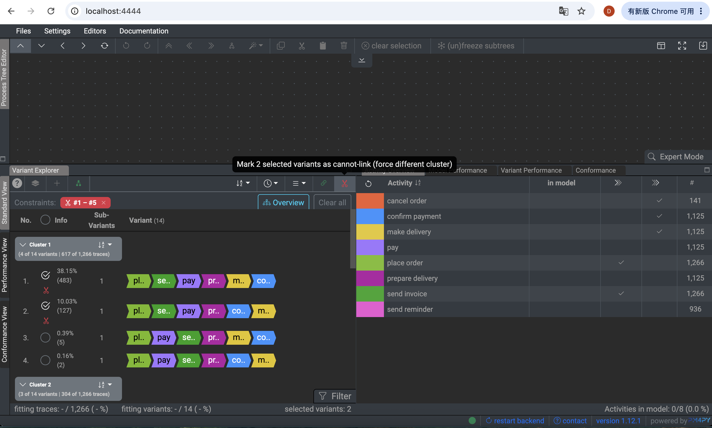
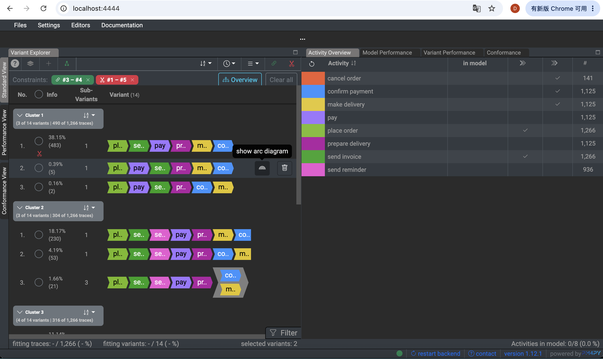
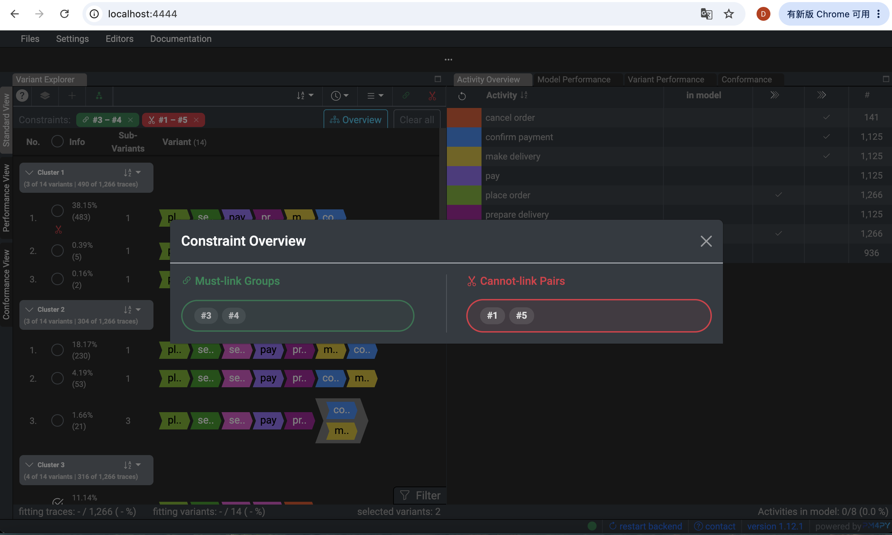

# Interactive Constrained Variant Clustering

## Overview

This repository extends the original Cortado process mining tool with an interactive constraint-based post-processing step for variant clustering.
Instead of replacing Cortado's existing clustering algorithms, this extension allows users to interactively specify **must-link** and **cannot-link** constraints between variants after an initial clustering has been created.
The extension then recomputes the clustering while enforcing the specified constraints.

Supported constraint types:

- **Must-link:** the selected variants must belong to the same cluster.
- **Cannot-link:** the selected variants must belong to different clusters.

The implementation is designed as a post-processing step and therefore remains fully compatible with Cortado's existing clustering methods.


# Installation

No additional installation steps are required for this extension. Please follow the setup instructions in the original `README.md`.
After installing the required frontend and backend dependencies, start Cortado as described in the original documentation.


# Using the Extension

The constrained clustering workflow consists of two clustering runs.

## Step 1 — Import an Event Log

Import an event log exactly as in the original Cortado application. After the import has finished, the variants will appear in the Variant Explorer.



*Figure 1. Variant Explorer after importing an event log.

## Step 2 — Create the Initial Clustering

Open

```
Functions
→ Variant Clustering
```

Select one of Cortado's existing clustering algorithms.

For example:
- Label Vector Clustering
- Agglomerative Edit Distance Clustering

Configure the desired clustering parameters and click **Apply**. This creates the **initial clustering**. At this point, **no constraints have been applied yet**.



*Figure 2. Open the Variant Clustering dialog.*



*Figure 3. Configure the clustering algorithm and execute the initial clustering.*

## Step 3 — Define Constraints

After the initial clustering has been generated, users may define constraints between variants. Select **exactly two variants** in the Variant Explorer. Then choose one of the two available actions.


### Must-Link

Click the green button

```
Mark 2 selected variants as must-link
(force same cluster)
```

The created constraint appears as a green label above the Variant Explorer.


### Cannot-Link

Click the red button

```
Mark 2 selected variants as cannot-link
(force different cluster)
```

The created constraint appears as a red label. Constraints may be added repeatedly.

Existing constraints can be removed individually using the **×** button.



*Figure 4. Creating a cannot-link constraint between two selected variants.*


*Figure 4. Creating a cannot-link constraint between two selected variants.*


## Step 4 — Apply the Constraints

After all desired constraints have been defined, open

```
Functions
→ Variant Clustering
```

again.

The previously selected clustering algorithm and its parameters can be kept. Click **Apply** once more. During this second clustering run, the extension performs the constraint-aware post-processing.

> **Important**
> Adding or removing constraints **does not automatically recompute the clustering**.
> The constrained clustering is only executed after the user opens the Variant Clustering dialog again and clicks **Apply**.

## Step 5 — Inspect the Final Clustering

After the second clustering run has completed, the Variant Explorer displays the final constraint-aware clustering.

The resulting clustering satisfies the user-defined constraints:
- variants connected by a must-link constraint belong to the same cluster;
- variants connected by a cannot-link constraint belong to different clusters.



*Figure 6. Final constraint-aware clustering after reapplying Variant Clustering.*



*Figure 7. Overview of the final clustering together with the active must-link and cannot-link constraints.*


# Processing Workflow

The extension performs the following workflow.

```text
Import Event Log
        │
        ▼
Run Cortado Variant Clustering
        │
        ▼
Initial Clustering
        │
        ▼
Create Must-Link / Cannot-Link Constraints
        │
        ▼
Run Variant Clustering Again
        │
        ▼
Constraint Validation
        │
        ▼
Must-Link Cluster Merge
        │
        ▼
Cannot-Link Conflict Repair
        │
        ▼
Final Constraint-Aware Clustering
```


# Implementation Summary

The extension keeps Cortado's original clustering pipeline unchanged. Instead, the generated clusters are passed to a post-processing module which:
1. validates the submitted constraints;
2. merges clusters connected through must-link constraints;
3. repairs cannot-link violations by relocating variants or must-link components;
4. returns the repaired clustering to the frontend.

This design allows the extension to remain compatible with Cortado's existing clustering algorithms.


# Notes

- The extension is implemented as a post-processing step.
- Cortado's original clustering algorithms are not modified.
- Constraints apply only to the currently loaded event log.
- After changing constraints, the user must execute Variant Clustering again by clicking **Apply**.